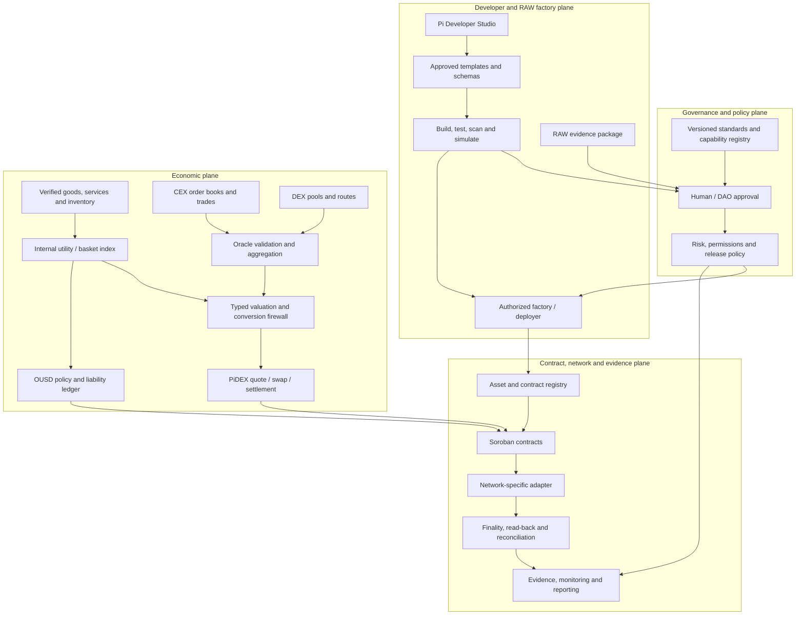

# PiRC — Pi Requests for Comment

PiRC is a community-led research, standards, and reference-engineering workspace for a proposed Pi ecosystem. It connects economic models, governance proposals, application interfaces, Soroban reference contracts, and evidence-driven release processes.

> **Project status:** This repository is not an official Pi Network specification or product. Nothing here implies Pi Core Team endorsement, a guaranteed Pi price, a USD peg, a bank, an exchange, a redemption right, or production deployment. Specifications and implementations are proposals until independently reviewed and verified.

## 1. Vision and operating principles

The project explores how a modular, auditable application ecosystem could coordinate identity, authorization, governance, dispute handling, asset provenance, payments, commerce, settlement, oracle observations, risk controls, reserve attestations, treasury accounting, revenue-funded utility, application services, dashboards, monitoring, and release evidence.

Core principles:
1. **Explicit ownership:** every standard, contract, API, schema, and workflow has one authoritative owner.
2. **Versioned interfaces:** repositories integrate through versioned schemas and manifests, not by copying entire branches.
3. **Least privilege:** signing, payments, deployment, and destructive automation are isolated and require explicit authorization.
4. **Provenance:** record source, issuer, network, evidence, timestamp, verification state, and responsible authority.
5. **Reproducibility:** every lifecycle transition requires tests and evidence that another reviewer can reproduce.
6. **Conservative claims:** distinguish proposed, simulated, testnet-verified, audited, and mainnet-verified capabilities.

## 2. Repository map and source-of-truth boundaries

| Repository | Authoritative responsibility | Must not become |
|---|---|---|
| [PiRC](https://github.com/Ze0ro99/PiRC) | Normative proposals, standards, economics, governance, architecture, schema registry, release requirements | A claim that proposals are official Pi Network policy |
| [SmartContracts](https://github.com/Ze0ro99/SmartContracts) | Soroban/Rust contract source, public interfaces, storage, authorization, contract tests, build configuration | A folder-count proxy for implementation coverage |
| [Unity Sphere](https://github.com/Ze0ro99/project-unity-sphere-0e2c810d) | PiDEX/application UI, APIs, adapters, asset registry views, monitoring, operations | Evidence that simulated markets, assets, or reserves are live |

**Ownership rule:** PiRC defines what a standard requires; SmartContracts implements contract-level behavior; Unity Sphere consumes versioned interfaces and exposes application workflows. Changes crossing these boundaries require traceability updates and coordinated review.

## 3. System architecture

The architecture is organized into seven conceptual layers. Their colors and names are proposal/UI semantics, not official Pi Network token classes or deployed asset tiers.

| Layer | Color | Conceptual responsibility | Example scope |
|---:|---|---|---|
| 1 | Red | Root governance and protocol controls | Policy, roles, emergency authority |
| 2 | Orange | Basic utility reference | Low-complexity utility and exchange of value |
| 3 | Yellow | Extended utility reference | Commerce and service utility |
| 4 | Green | PiCash/payment proposal | Payment intents, merchant flows, accounting |
| 5 | Blue | Institutional interface proposal | Treasury, custody, institutional workflows |
| 6 | Indigo | Premium reserve proposal | Reserve evidence and restricted eligibility models |
| 7 | Purple | Mined Pi and fractional accounting representations | Provenance-aware balances and atomic-unit accounting |

The source material also contains a **Gold** registry entry. Gold is an unresolved registry taxonomy item; it is not silently treated as Indigo. Resolve this through a versioned registry migration and compatibility tests.

### High-level workflow

Pioneer / Merchant / Operator → identity and policy checks → application/API boundary → versioned asset and payment schemas → contract authorization and state transition → ledger/network adapter → event and evidence capture → reconciliation, monitoring, and governance review.

The application must never bypass contract authorization. External agents may prepare proposals or observations, but must not receive unrestricted signing or treasury execution authority.

## 4. Standards, architecture, and documentation map

### Architecture and integration
- [Master Architecture](docs/architecture/MASTER_ARCHITECTURE.md)
- [Seven-Layer Hybrid Stack](docs/architecture/SEVEN_LAYER_HYBRID_STACK.md)
- [Seven Colored Layers Source Mapping](docs/architecture/SEVEN_COLORED_LAYERS_SOURCE_MAPPING.md)
- [Economic Component Integration Map](docs/architecture/ECONOMIC_COMPONENT_INTEGRATION_MAP.md)
- [Cross-Repository Implementation Traceability Matrix](docs/integration/IMPLEMENTATION_TRACEABILITY_MATRIX.md)
- [Contract and API Traceability Matrix](docs/integration/CONTRACT_API_TRACEABILITY_MATRIX.md)
- [Cross-Repository Review and Acceptance Matrix](docs/integration/CROSS_REPO_REVIEW_MATRIX.md)
- [External Component Compatibility Matrix](docs/integration/EXTERNAL_COMPONENT_COMPATIBILITY_MATRIX.md)
- [Branch Intake Inventory](docs/integration/BRANCH_INTAKE_INVENTORY.md)
- [Complete Branch Census](docs/integration/BRANCH_CENSUS.md)
- [Branch Head Audit](docs/integration/BRANCH_HEAD_AUDIT_2026-11-03.md)
- [Source Implementation Audit](docs/integration/SOURCE_IMPLEMENTATION_AUDIT_2026-11-03.md)

### Economic model and mathematics
- [Economic Mathematics](docs/economics/ECONOMIC_MATHEMATICS.md)
- [Monetary Model and Inflation Equations](docs/economics/MONETARY_MODEL_AND_INFLATION_EQUATIONS.md)
- [Executable Economic Engine Specification](docs/economics/ECONOMIC_ENGINE_EXECUTION_SPEC.md)
- [Oracle Engine Execution Specification](docs/standards/ORACLE_ENGINE_EXECUTION_SPEC.md)
- [Unified Contract/API Interface Specification](docs/integration/UNIFIED_CONTRACT_API_INTERFACE_SPEC.md)
- [SoloHost Package Validation Specification](docs/architecture/SOLOHOST_PACKAGE_VALIDATION_SPEC.md)
- [Monetary Model, Inflation, and Equations](docs/economics/MONETARY_MODEL_AND_INFLATION_EQUATIONS.md)
- [Economic System Integration Blueprint](docs/economics/ECONOMIC_SYSTEM_INTEGRATION_BLUEPRINT.md)
- [End-to-End Economic Lifecycle](docs/economics/END_TO_END_ECONOMIC_LIFECYCLE.md)
- [Treasury, Revenue, and Distribution Model](docs/economics/TREASURY_REVENUE_AND_DISTRIBUTION_MODEL.md)
- [Internal and External Value Bridge](docs/economics/INTERNAL_EXTERNAL_VALUE_BRIDGE_SPEC.md)

### Standards and evidence
- [Versioned Schema Registry](docs/standards/SCHEMA_REGISTRY.md)
- [Payment Event Schema](schemas/v1/payment-event.schema.json)
- [Economic Settlement Schema](schemas/v1/economic-settlement.schema.json)
- [Oracle Observation Schema](schemas/v1/oracle-observation.schema.json)
- [Asset Provenance Schema](schemas/v1/asset-provenance.schema.json)
- [Seven-Layer Registry Schema](schemas/v1/seven-layer-registry.schema.json)
- [Seven-Layer Registry Data](registries/seven-layer-registry.v1.json)
- [Asset and Token Lifecycle](docs/standards/ASSET_TOKEN_LIFECYCLE_AND_LAUNCHPAD.md)
- [Oracle Data Quality and Governance](docs/standards/ORACLE_DATA_QUALITY_AND_GOVERNANCE.md)
- [Commerce Valuation and Provenance](docs/standards/COMMERCE_VALUATION_AND_PROVENANCE_STANDARD.md)
- [AI Agent Capability and Safety](docs/standards/AI_AGENT_CAPABILITY_AND_SAFETY_STANDARD.md)
- [Pi Testnet1 Network Profile](docs/standards/PI_TESTNET1_NETWORK_PROFILE.md)
- [Testnet1 Release Gates and Mainnet Readiness](docs/standards/TESTNET1_RELEASE_GATES.md)
- [OUSD Test-Only Asset Profile](docs/standards/PiRC-OUSD-TEST.md)

### External desktop and distribution references
- [SoloHost package contract](https://github.com/pi-node/solohost/blob/main/skills/solohost-package/references/contract.md)
- [SoloHost package skill](https://github.com/pi-node/solohost/blob/main/skills/solohost-package/SKILL.md)
- [Hermes SoloHost reference package](https://github.com/pi-node/solohost/tree/main/skills/solohost-package/examples/hermes)
- [pi-node repository](https://github.com/pi-node/pi-node) — current public README reports 0.5.4; team-provided Desktop target 0.6.4 remains to be verified on-device.
- [External Component Compatibility Matrix](docs/integration/EXTERNAL_COMPONENT_COMPATIBILITY_MATRIX.md)

### Application and developer integration
- [PiRC API server](artifacts/api-server)
- [Vercel Pi Platform Setup](docs/deployment/VERCEL_PI_PLATFORM_SETUP.md)
- [Unity Sphere API and registry documentation](https://github.com/Ze0ro99/project-unity-sphere-0e2c810d/tree/main/docs/api)

## 5. Economic model: quantities, value, inflation, and limits

The project separates external observed price, internal reference value, delivered utility, collected revenue, reserve coverage, settlement liquidity, token supply, and velocity. These are different measures and must not be conflated.

### Illustrative ratio — arithmetic, not a peg

For research parameters P_i = 314,159 and P_e = 0.0314159:

\[
S = \frac{P_i}{P_e} = 10,000,000
\]

This is a mathematical ratio only. It does **not** authorize converting, redeeming, swapping, or settling one Pi at either value, and it does not establish a 10,000,000× arbitrage mechanism. Any economic use requires defined units, enforceable obligations, independently verified revenue/liquidity, eligibility, and an explicit conversion policy.

### Revenue-funded allocation

For distributable utility/revenue U and eligible participant weight w_i:

\[
B_i = U \cdot \frac{w_i}{\sum_j w_j}
\]

Preconditions: U ≥ 0, finite non-negative weights, a positive denominator, and eligibility resolved before calculation. Use integer atomic units, deterministic remainder allocation, and the invariant Σ B_i = U.

### Inflation and monetary discipline

The project distinguishes consumer-price inflation from token-supply growth. Supply expansion is not itself proof of consumer-price inflation; price effects depend on demand, velocity, productive output, market structure, and expectations. See the dedicated mathematical note for definitions, assumptions, and limitations.

## 6. Contract and API lifecycle

Every standard-to-code mapping must identify the normative specification and revision, acceptance criteria and invariants, contract crate and public interface, storage schema and authorization matrix, unit/integration/boundary/adversarial tests, threat model and dependency/toolchain versions, network profile, deployment transaction, contract ID, code hash, verification timestamp, and independent review status.

Use the lifecycle:

PROPOSED → SPECIFIED → IMPLEMENTED → TESTED → TESTNET_VERIFIED → AUDITED → MAINNET_VERIFIED

No state may be skipped. A source path or build success does not establish deployment or audit status.

### Current contract audit warning

The SmartContracts default-branch audit reports 106 Rust source files but only four distinct Rust file contents by Git blob SHA, with large groups of numbered crates reusing templates. Treat those crates as scaffolds unless their independent behavior, authorization, storage, tests, and invariants are demonstrated. The integration branch contains newer reference modules for registry, oracle observations, and reserve attestations; they remain un-deployed and require validation. See the [SmartContracts audit](https://github.com/Ze0ro99/SmartContracts/blob/main/docs/CONTRACT_COVERAGE_AND_SECURITY_AUDIT.md).

## 7. Pi Desktop 0.6.4 compatibility preparation

SoloHost and Hermes are treated here as components referenced by the team's **Pi Desktop 0.6.4 release context**. Their current role in this project is a **compatibility-preparation and capability-demonstration exercise**.

This statement does not mean their source repositories have been imported, that a production integration exists, or that compatibility has been independently certified. The compatibility proof must record:
1. exact desktop release and runtime/platform;
2. component identity, version, and source provenance;
3. supported API/protocol and capability negotiation;
4. authentication and permission boundaries;
5. network, filesystem, process, and signing access requested;
6. test cases, logs, expected/actual outcomes, and known limitations;
7. reproducible evidence and reviewer sign-off.

Until those records exist, label the relationship **PREPARATION / NOT VERIFIED**. Do not grant signing, wallet, treasury, deployment, or destructive filesystem capabilities merely to demonstrate compatibility. See [Pi Desktop 0.6.4 Compatibility Preparation](docs/architecture/PI_DESKTOP_064_COMPATIBILITY_PROFILE.md).

## 8. Branch strategy and integration workflow

The 2026-11-03 branch census records **577 branch refs and 558 unique head commits** across the three repositories at census time. A branch name is not a feature specification and a unique commit is not automatically safe to merge.

Required intake sequence:
1. enumerate branch refs and deduplicate by commit SHA;
2. compare each unique head with its repository base;
3. inspect changed files and commit history;
4. classify changes as standards, economics, contracts, APIs, UI, workflows, or deployment;
5. map every accepted change to an owner, standard, tests, and evidence;
6. reject or isolate destructive, over-privileged, secret-bearing, or non-deterministic automation;
7. integrate in small, reviewable PRs;
8. run repository-native checks and cross-repository compatibility tests;
9. preserve original branches and history;
10. merge only after required reviews and checks pass.

Do not bulk-merge all branches. Some are duplicates, stale snapshots, automated repair branches, dependency updates, or workflows with destructive behavior. The branch census and intake/risk reviews are inventories and triage inputs, not blanket approval.

## 9. Security, secrets, and operations

- Never commit secret values, private keys, API tokens, seed phrases, or signing material.
- Keep credentials in GitHub/Vercel encrypted secret stores and scope them by environment.
- Use separate sandbox, Testnet, and production credentials.
- Fail closed when required credentials or network identity are missing.
- Require idempotency, replay protection, amount/product validation, and server-side payment verification.
- Require explicit allowlists, human approval, dry-run mode, and rollback plans for deployment.
- Do not activate workflows that harvest all branches, delete source directories, or deploy every discovered WASM artifact.
- Treat OUSD as test-only until issuer, reserve, custody, legal, and redemption evidence is independently established.
- Treat PiDEX market cards and local simulations as simulations unless venue, liquidity, and transaction execution are verified.

## 10. Development and validation

Use the repository's pinned package manager, lockfiles, toolchains, and workflow definitions. Typical checks include documentation/schema validation; TypeScript typecheck and frontend/API builds; Rust formatting, workspace tests, and target-specific WASM builds; contract authorization and invariant tests; API health, payment fail-closed, and idempotency smoke tests; cross-repository schema compatibility tests; dependency, secret, and static security scans.

A local pass is not a hosted deployment. A CI pass is not an independent security audit. A Testnet transaction is not Mainnet verification.

## 11. Contribution checklist

Every pull request should include the relevant PiRC standard(s) and revision, ownership boundary and affected repositories, schema/interface compatibility impact, threat model and permissions changed, tests and reproducible commands, evidence links and limitations, and migration/rollback/release notes where applicable.

Preserve source branches. Prefer focused PRs over broad merges. Do not commit secrets. Do not describe proposed or simulated capabilities as live.

## Integrated delivery and release evidence
- [Cross-repository integration delivery dossier](docs/integration/INTEGRATION_DELIVERY_DOSSIER_2026-11-03.md)
- [Architecture decision records](docs/architecture/INTEGRATION_DECISION_RECORDS.md)
- [Integrated release acceptance checklist](docs/release/INTEGRATED_RELEASE_ACCEPTANCE_CHECKLIST.md)

## Integration status report
- [Cross-repository integration status report](docs/release/INTEGRATION_STATUS_REPORT_2026-11-03.md)

## Upstream PiRC review and mathematical gap analysis
- [Upstream PiRC feedback, economic model, and integration gap analysis](docs/integration/UPSTREAM_PIRC_FEEDBACK_AND_ECONOMIC_GAP_ANALYSIS_2026-11-03.md)

## Economic settlement handoff

- [Cross-repository economic settlement contract handoff](docs/integration/ECONOMIC_SETTLEMENT_CONTRACT_HANDOFF_2026-11-03.md)

## Integrated architecture and engineering package — 2026-11-03

## Integrated architecture and engineering package — 2026-11-03

- [Integrated System Blueprint](docs/architecture/INTEGRATED_SYSTEM_BLUEPRINT_2026-11-03.md)
- [Cross-Repository Sequence and Data Flows](docs/architecture/CROSS_REPOSITORY_SEQUENCE_AND_DATA_FLOWS.md)
- [Integration Decision Records](docs/architecture/INTEGRATION_DECISION_RECORDS_2026-11-03.md)
- [Cross-Repository Interface Contract](docs/integration/CROSS_REPOSITORY_INTERFACE_CONTRACT.md)
- [Integrated Threat Model](docs/security/INTEGRATED_THREAT_MODEL.md)
- [Cross-Repository Test Strategy](docs/testing/CROSS_REPOSITORY_TEST_STRATEGY.md)
- [Observability and Incident Runbook](docs/operations/OBSERVABILITY_AND_INCIDENT_RUNBOOK.md)
- [Netlify Deployment Boundary](docs/deployment/NETLIFY_DEPLOYMENT_BOUNDARY.md)
- Netlify build configuration: `netlify.toml`
- Lightweight docs/config validator: `scripts/validate_docs_and_deploy_config.py`
- CI workflow: `.github/workflows/integrated-validation.yml` (schema/config validation plus the same static frontend build used by Netlify; publishes a short-lived build artifact)

The Netlify configuration targets the static Vite frontend only. The existing Vercel catch-all API entry is not a Netlify Function; `/api/*` deliberately returns 404 until a separately hosted API or tested Netlify Functions adapter is configured.

## Integrated sovereign economic architecture
- [Sovereign Economic System Architecture](docs/architecture/SOVEREIGN_ECONOMIC_SYSTEM_ARCHITECTURE.md)
- [Integrated Economic Flow Maps](docs/architecture/INTEGRATED_ECONOMIC_FLOW_MAPS.md)

These documents define the dual-value boundary, revenue-funded utility, mint/burn semantics, fairness allocation, sovereign-index limitations, cross-repository ownership and release lifecycle. They are community reference specifications, not official Pi Network policy or evidence of a live peg, reserve, bank, exchange or redemption facility.

## Omni Factory and Dual-Economy Architecture
- [Omni Factory and Dual-Economy Reference Architecture](docs/architecture/OMNI_FACTORY_AND_DUAL_ECONOMY_REFERENCE.md)
- [Branch Feature Intake and Evidence Register](docs/integration/BRANCH_FEATURE_INTAKE_AND_EVIDENCE_REGISTER.md)

This reference defines RAW evidence, governed contract generation, internal utility valuation, CEX/DEX price observations, oracle boundaries, OUSD stability options, seven-layer taxonomy, AI-assisted feature governance, differential-geometry risk modelling and post-quantum crypto agility. It distinguishes documented/scaffolded/simulated/tested/deployed capabilities and does not assert Pi Core Team endorsement or native Pi protocol changes.

## 6. Unified execution architecture (cross-repository baseline)

The following model is a proposed integration contract. It describes the intended control flow; it does not claim that every component is implemented, deployed, audited, or supported by Pi Network.

### 6.1 System-of-record boundaries

| Domain | Canonical owner | Integration contract |
|---|---|---|
| Standards, economic policy, schemas, governance and risk | PiRC | Versioned specifications, schemas, golden vectors and release gates |
| Contract execution, authorization, storage, events and deterministic tests | SmartContracts | Versioned ABI, contract IDs, code hashes, events and test evidence |
| Developer Studio, RAW workflows, PiDEX UI, APIs, adapters and monitoring | Unity Sphere | Versioned API clients, network profiles, UI state and reconciliation |
| External observations | Configured independent providers | Signed, timestamped, typed observations with source and quality metadata |
| Physical/legal evidence | Issuer, custodian, inspector and evidence service | Signed claims, document commitments, provenance and dispute records |

A repository may consume another repository's interface, but must not silently fork its normative meaning. Every release manifest should pin specification version, schema version, contract artifact/code hash, application version, SDK/toolchain version, network ID and environment.

### 6.2 End-to-end transaction lifecycle

1. Discover the asset, capability and network in the versioned registries.
2. Validate identity, issuer authority, permissions, eligibility and policy version.
3. Resolve the value domain: internal utility, merchant quote, external market observation, accounting mark, collateral mark or redeemable liability.
4. Validate source evidence and oracle quality where required.
5. Build a typed quote with amount, unit, decimals, expiry, fees, terms hash and idempotency key.
6. Present the exact transaction and require explicit user authorization.
7. Simulate and submit through the network-specific adapter.
8. Verify transaction finality and read back contract state.
9. Reconcile application, contract, merchant, inventory and treasury records.
10. Emit immutable evidence events and update monitoring only from reconciled results.

Failure at any mandatory stage must fail closed. A UI success state, API 200 response, transaction submission, event emission or contract address alone is not proof of final settlement.

## 7. Dual-value economy and unit discipline

### 7.1 Value domains

Never store all monetary meanings in a generic `price` field.

| Type | Meaning | Settlement authority |
|---|---|---|
| Internal reference | Policy-controlled accounting coordinate or utility index | Not a payment or redemption promise by itself |
| Merchant quote | Expiring offer for a specified product/service | May authorize a payment after user approval and supported settlement |
| External market quote | Price observed on a named CEX/DEX venue and pair | Use only under a defined market-data policy |
| Accounting mark | Reporting value under a stated methodology and period | Reporting only |
| Collateral mark | Risk-adjusted valuation after haircuts and limits | Risk calculation only |
| Redeemable liability | Enforceable obligation of a named issuer | Only under the issuer's disclosed redemption process |

The internal/external bridge is a typed workflow, not an automatic converter. The illustrative ratio
`S = P_internal / P_external`
may be used for scenario analysis. For example, `314159 / 0.0314159 = 10,000,000`. This is arithmetic, not a market target, exchange entitlement, arbitrage path, reserve or redemption promise. The ratio must never trigger wallet mutation, mint, burn or automatic conversion.

### 7.2 Internal basket valuation

For each eligible item `i`, define a normalized verified local offer:
`r_i,t = verified_offer_i,t / base_offer_i`

A weighted basket index can be:
`I_t = sum(w_i * r_i,t) / sum(w_i)`
with `w_i >= 0`, a documented basket version and a positive denominator.

An internal accounting unit may be represented as:
`U_internal,t = U_0 * I_t`

The index must disclose coverage, geography, substitutions, freshness, confidence, methodology and missing-data treatment. Missing observations reduce coverage; they must not be silently treated as zero or fabricated. An index does not create a USD peg or a promise to deliver the basket. Stability depends on enforceable merchant supply, fulfilment capacity, inventory, pricing policy and operational reserves.

Internal utility can grow through verified supply, quality, productivity, merchant availability, service delivery and real demand. Decimal expansion or token issuance alone does not create purchasing power.

### 7.3 External market valuation

For CEX data, capture venue, pair, bid/ask depth, trades, executable VWAP for a defined notional, timestamps, venue status and deposit/withdrawal status. For DEX data, capture verified pool identity, reserves, fee, route, ledger/block, executable quote, price impact, slippage and finality risk.

A composite external reference may use:
`P_ext = Aggregate(valid observations, policy_version)`
where the aggregation policy explicitly defines independent-source quorum, liquidity and volume eligibility, venue concentration, freshness, outlier handling, confidence and deterministic rounding. Reported volume alone is not a valid weight. CEX and DEX observations must not be treated as interchangeable.

### 7.4 Provenance and conversion firewall

Suggested application-level provenance labels: `MINED`, `MIGRATED`, `PURCHASED`, `EARNED`, `MERCHANT_RECEIVED`, `BRIDGED`, `ISSUED`, and `UNKNOWN`. These labels do not imply that a fungible on-chain balance carries protocol-enforced provenance. Store evidence type, source transaction/ledger, timestamp, confidence and verification status; never infer legal ownership from an address alone.

Cross-class conversion is rejected by default. An explicitly authorized conversion requires source/destination asset IDs, rate provenance, policy version, fees, limits, user consent, compliance review, settlement proof and reconciliation.

## 8. Monetary arithmetic, weights and decimal expansion

### 8.1 Atomic units

All settlement and contract arithmetic uses integer atomic units. For an asset with `d` decimals:
`atomic_amount = whole_amount * 10^d`
and display conversion is performed only at the presentation boundary. Rates must carry explicit numerator, denominator, scale, quote unit and rounding rule. Binary floating point is prohibited in consensus-critical, accounting and settlement paths.

Increasing `d` changes representable granularity, not total economic value:
`display_amount = atomic_amount / 10^d`
It does not multiply the user's purchasing power or market capitalization. Decimal changes require a versioned migration, supply conservation, compatibility checks and explicit treatment of dust.

### 8.2 Contribution and distribution weights

Let `D_t` be verified distributable surplus and `w_i` an approved non-negative contribution weight:
`B_i = D_t * w_i / sum_j(w_j)`

Define:
`D_t = max(0, R_t - C_t - L_t)`
where `R_t` is collected and reconciled revenue, `C_t` is verified costs/refunds/taxes/provisions, and `L_t` is required liquidity and risk reserves.

Eligibility must be decided before allocation. Reject zero total weight, negative values, overflow and ineligible participants. For integer outputs, allocate the remainder deterministically (for example, largest remainder with a stable participant-ID tie-break) so:
`sum_i(B_i_atomic) = D_t_atomic`

This is an accounting model, not a guaranteed user entitlement, yield promise or price-support mechanism. GMV, uncollected invoices, circular transfers and speculative appreciation are not revenue.

### 8.3 Risk and liquidity indicators

- Reserve coverage: `CR = eligible_haircut_reserves / redeemable_liabilities`.
- Settlement liquidity: `LR = available_unencumbered_liquidity_in_window / required_settlement`.
- Oracle deviation: `Dev = abs(P_new - P_ref) / P_ref`, with explicit zero-reference handling.
- Velocity indicator: `V = (P * Q) / M`, only after defining period, price index, supply and transfer scope.

A reserve ratio above one does not prove immediate liquidity, legal ownership or absence of liens. If liabilities are zero, report reserve coverage as `NOT_APPLICABLE`, not infinity.

## 9. Oracle and Chainlink integration policy

Canonical observation tuple:
`(feed_id, base_asset, quote_asset, value_atomic, scale, source_id, sequence, observed_at, expires_at, key_id, signature, evidence_hash)`.

Pipeline:
1. Validate schema and feed policy.
2. Resolve exact asset pair, unit, scale, network and active signing key.
3. Canonicalize the payload and verify signature.
4. Enforce timestamp freshness, expiry and monotonic source sequence.
5. Reject duplicate IDs, replay, malformed units and conflicting sequence payloads.
6. Apply source-specific liquidity, venue, deviation and outlier checks.
7. Require the configured number of independently controlled sources.
8. Aggregate deterministically (for example, median after eligibility filters).
9. Publish constituent IDs, accepted/rejected counts, policy version and quality state.
10. Allow settlement consumers to use only a fresh, quorum-valid result.

A signature proves control of a key, not truth. An AI score or proof hash is not an oracle attestation. Chainlink AggregatorV3 is chain-specific: verify exact chain, feed proxy, decimals, heartbeat, round completeness, `updatedAt`, access restrictions and coverage. An EVM feed is not automatically callable from Soroban. Where no native integration is proven, use a separately reviewed adapter/relayer with signed evidence and on-chain verification. If quorum or freshness fails, return `UNAVAILABLE` or expose a clearly stale display-only value; never silently fall back to one source.

## 10. RAW Factory, physical assets and Pi Developer Studio

RAW is an evidence and rights workflow, not a magic tokenization switch.

Physical asset lifecycle:
`DRAFT → REGISTERED → EVIDENCE_PENDING → INSPECTED → TITLE_REVIEWED → CUSTODY_CONFIRMED → VALUED → GOVERNANCE_APPROVED → TEMPLATE_DEPLOYED → READBACK_VERIFIED → ACTIVE`
Alternative terminal or interim states include `REJECTED`, `DISPUTED`, `FROZEN`, `REVOKED` and `REDEEMED`. Each transition needs an authorized actor, timestamp, evidence reference, policy version and reason.

A RAW evidence envelope should bind asset ID, issuer, jurisdiction, legal-right type, document commitments, inspector/custodian identity, device certificate, nonce, expiry, signed sensor/inspection payload, valuation source and dispute status. Keep personal data and bulky documents off-chain under access control; store hashes and signed claims only where appropriate. A hash proves integrity of bytes, not authenticity, title, possession or physical existence. QR/NFC identifiers are locators, not proof of ownership.

The Pi Developer Studio pipeline is:
`Capability request → schema and policy resolution → approved template selection → code generation → build/lint/tests/fuzz/SBOM → sandbox simulation → human/governance review → testnet deployment → transaction/code-hash/state read-back → registry publication → monitoring`.

A production RAW factory must deploy an approved immutable template, use deterministic salt and idempotency keys, authorize a deployer, control fees/retries, register the child contract, and verify code hash and initialized state by read-back. An event, product ID or placeholder transaction string is not deployment evidence.

## 11. PiDEX execution and liquidity

For a constant-product pool with reserves `x`, `y`, input `dx`, fee denominator `D` and fee `F`:
`dx_net = floor(dx * (D-F) / D)`
`dy = floor(dx_net * y / (x + dx_net))`
`k = x * y` (subject to fees, rounding and the implementation's invariant).

A quote must bind pool ID, token IDs, decimals, reserves, fee, route, input, minimum output, slippage tolerance, expiry, ledger/block and policy version. Check zero reserves, overflow, token authorization, minimum output, price impact, pool pause, reserve conservation, rounding dust and re-entrancy/callback risks where relevant. Multi-hop routes require deterministic intermediate rounding and atomic all-or-nothing settlement.

CEX VWAP, DEX spot price and PiDEX executable quote are different data types. Never use a displayed mid-price as proof of executable liquidity. The legacy floating-point PiDEX engine is simulation-only until replaced and parity-tested with integer arithmetic.

## 12. OUSD: internal stability without false backing claims

OUSD must be modeled according to one explicit product type:
1. Internal unit of account — non-transferable accounting coordinate unless terms explicitly permit otherwise.
2. Basket-backed utility credit — a defined claim on specified goods/services, with enforceable delivery, substitutions and dispute rules.
3. USD-redeemable stablecoin — a legal issuer obligation requiring segregated eligible reserves, custody, daily reconciliation, independent attestations, disclosed redemption, liquidity and insolvency treatment.

Do not call types 1 or 2 a USD stablecoin. An oracle target is not backing. For a redeemable liability:
`CR = eligible_reserves_after_haircuts / outstanding_redeemable_liabilities`
Issuance is bounded by verified eligible reserves and legal authorization; mint/burn, redemption queues, fees, SLA, depeg controls, custody failure and emergency governance must be specified. Internal prices should be anchored to a governed goods/services basket and fulfilment capability, not mechanically follow CEX Pi volatility. OUSD remains test-only until issuer, rights, reserves, custody, attestations, redemption and independent security review are proven.

## 13. Seven-layer taxonomy and asset registry

The seven-layer taxonomy is a community UI/proposal model, not an official Pi Network token classification. Preserve the existing mapping and the unresolved Gold-versus-Indigo discrepancy; do not silently relabel either category. Each registry record must include canonical asset ID, symbol, issuer, network, contract ID, decimals, supply model, permissions, metadata URI, price policy, reserve policy, deployment transaction, code hash and evidence status. Unknown data remains null or `UNVERIFIED`.

## 14. AI agents, automatic feature creation and governance

Agents may discover gaps, propose capabilities, draft schemas, generate code from pinned templates, run tests, explain failures and open pull requests. They may not approve their own work, merge protected branches, access production secrets, sign arbitrary transactions, change monetary policy, mint/burn, or deploy to production without explicit authorized human/governance action.

Every generated feature must have:
- stable `capability_id`, semantic version and schema version;
- owning repository and layer/domain tags;
- exact network support and asset scope;
- dependencies, pinned hashes and SDK/toolchain versions;
- permissions, threat model and risk classification;
- required legal, physical, oracle, reserve and security evidence;
- unit/property/fuzz/integration/adversarial conformance tests;
- human reviewer, governance decision and rollback plan.

Lifecycle:
`DISCOVERED → DRAFTED → SPECIFIED → REVIEWED → APPROVED_FOR_IMPLEMENTATION → IMPLEMENTED → TESTED → TESTNET_VERIFIED → AUDITED → PRODUCTION_VERIFIED`.
Rejected, deprecated or disputed capabilities remain traceable with reasons. The registry may automate discovery and compatibility checks, but policy acceptance is governed, not self-awarded by an agent.

## 15. Cryptographic agility and post-quantum migration

Separate transport encryption, key agreement, signatures, hashing, identity and ledger consensus. Version algorithm identifiers and key epochs in signed records. Evaluate hybrid migration and dual verification only where target runtime and counterparties support it. Candidate standards include NIST FIPS 203 (ML-KEM), FIPS 204 (ML-DSA) and FIPS 205 (SLH-DSA); selection requires implementation maturity, key/signature size, CPU, memory, transaction-size and runtime-budget measurements.

A branch name, SHA-256 digest or "quantum-secured" label is not post-quantum protection. On-chain PQ verification requires actual network/runtime support and measured resource budgets. Until then, use explicitly labeled off-chain attestations and do not claim ledger-level PQ security.

## 16. Security, privacy and operational invariants

- Network ID, passphrase, endpoint, contract ID and asset ID must be environment-bound.
- Use least privilege, scoped short-lived credentials, protected branches and secret scanning.
- Require multi-party authorization and timelocks for treasury, mint, burn, upgrade and emergency actions.
- Enforce replay protection, idempotency, checked arithmetic, explicit rounding and supply conservation.
- Keep personal and sensitive physical evidence off-chain; minimize collection and control access.
- Add pause/circuit-breaker, incident response, key rotation, recovery and deprecation procedures.
- Pin dependencies and toolchains; produce SBOMs and reproducible build evidence.
- Never let an autonomous agent obtain an unrestricted production signer.

## 17. Verification and release state model

Use the following evidence-backed lifecycle:
`PROPOSED → SPECIFIED → IMPLEMENTED → UNIT_TESTED → INTEGRATION_TESTED → SECURITY_REVIEWED → TESTNET_VERIFIED → AUDITED → PRODUCTION_CANDIDATE → PRODUCTION_VERIFIED`.

A transition requires reproducible evidence, commit SHA, workflow run, test report, environment, artifact hash and reviewer/approver. `PENDING`, `QUEUED`, `SKIPPED`, `CANCELLED` and `RATE_LIMITED` are not success. A failed or blocked check must remain visible. Deployment provider configuration must not be changed merely to clear a queue or rate limit without an approved change and rollback plan.

## 18. Cross-repository implementation references

- PiRC: normative architecture, economics, schemas, governance, oracle policies and release gates.
- SmartContracts: RAW factory, OUSD test token, oracle consumers, reserve attestations, PiDEX arithmetic and cryptographic implementation gates.
- Unity Sphere: Pi Developer Studio, RAW evidence workflows, APIs, PiDEX UI/router, CEX/DEX adapters, internal basket index, OUSD accounting, monitoring and reconciliation.

Related application references:
- [Omni Developer Studio, PiDEX and Physical Economy](https://github.com/Ze0ro99/project-unity-sphere-0e2c810d/blob/main/docs/architecture/OMNI_DEVELOPER_STUDIO_PIDEX_AND_PHYSICAL_ECONOMY.md)
- [Omni Capability Registry and Branch Intake](https://github.com/Ze0ro99/project-unity-sphere-0e2c810d/blob/main/docs/integration/OMNI_CAPABILITY_REGISTRY_AND_BRANCH_INTAKE.md)
- [RAW Factory, OUSD, Oracle and Cryptographic Gates](https://github.com/Ze0ro99/SmartContracts/blob/main/docs/RAW_FACTORY_OUSD_ORACLE_AND_CRYPTO_GATES.md)

---
This README is an engineering reference for a community proposal. It is not financial advice, an offer, a guarantee, a legal opinion, an official Pi Network specification, or evidence of live deployment, reserves, liquidity, audit or endorsement.

## 12. Independent Termux testing and economic integration

GitHub Actions is not required to execute the local validation workflow. Use the offline-first [Termux testing and economic architecture guide](docs/testing/TERMUX_TESTING_AND_ECONOMIC_ARCHITECTURE.md) and its runner:

- [Termux shell entrypoint](scripts/termux-test.sh)
- [Python validation runner](scripts/termux_validate.py)
- Reports are generated under `artifacts/termux-reports/` and must be reviewed/redacted before publishing.

The default runner performs local checks only. The optional `--network-smoke` profile performs read-only health checks against Pi Testnet and Stellar Testnet; it does not sign, submit transactions, deploy contracts, or target Mainnet. The economic model keeps internal reference values, external market observations, merchant utility quotes, accounting values, collateral marks, and redeemable liabilities as distinct typed domains. External CEX/DEX observations may inform a governed utility/valuation process but cannot automatically mutate internal prices or balances.

- [Termux secret handling and cross-repository intake triage](docs/security/TERMUX_SECRET_HANDLING_AND_REPO_TRIAGE.md)
