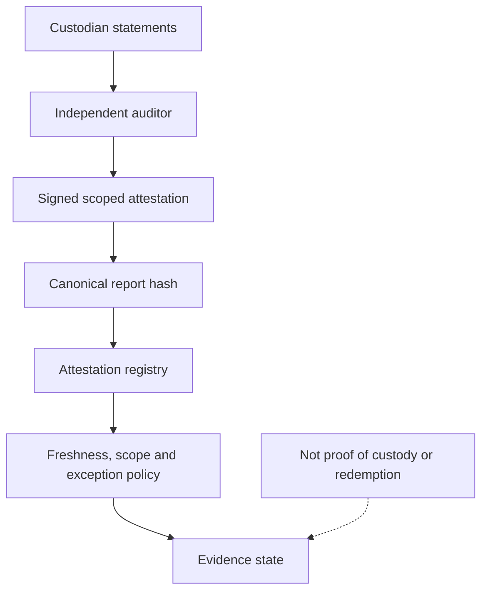
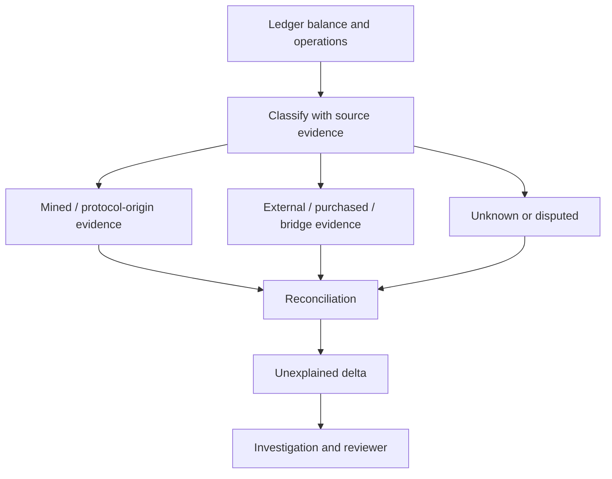
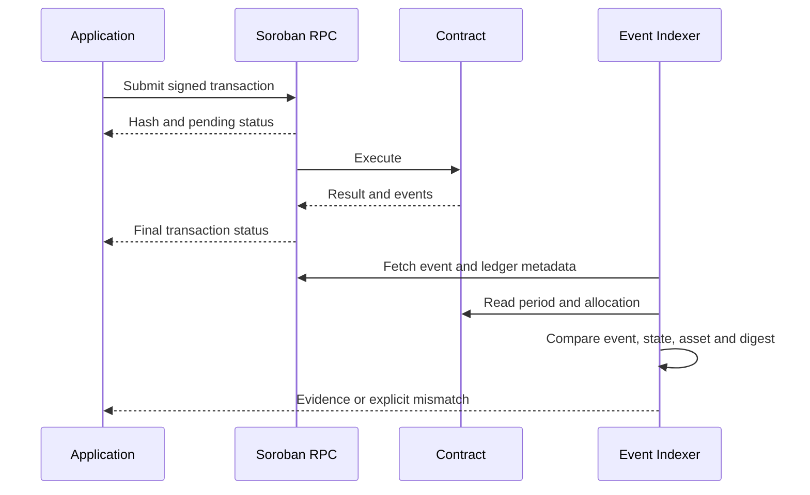

# Cross-Repository Sequence and Data Flows

**Status:** Proposed integration contract; see the Integrated System Blueprint.

## Oracle observation

```mermaid
flowchart LR
  SRC["Independent source"] --> AD["Source adapter"]
  AD --> SIG["Signature and identity check"]
  SIG --> TIME["Timestamp, sequence and freshness"]
  TIME --> UNIT["Unit normalization"]
  UNIT --> OUT["Outlier and deviation policy"]
  OUT --> QUORUM["Independent quorum"]
  QUORUM --> RESULT["Canonical signed observation"]
  RESULT --> VERIFY["Consumer verification"]
  VERIFY --> STORE["Evidence and audit event"]
```

One authenticated reporter observation is not a decentralized oracle quorum. A proof hash is not proof verification unless the proof system and verifier are implemented and tested.

## Reserve attestation

## Provenance and reconciliation

Never infer provenance from address shape, missing memo, exchange label or transaction pattern alone. Unknown/disputed amounts remain explicitly unclassified.

## Event and readback reconciliation

No UI status may be promoted to SETTLED until finality and readback reconciliation succeed.
