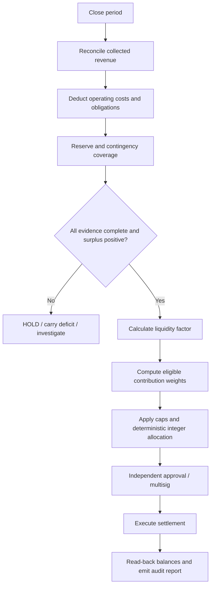
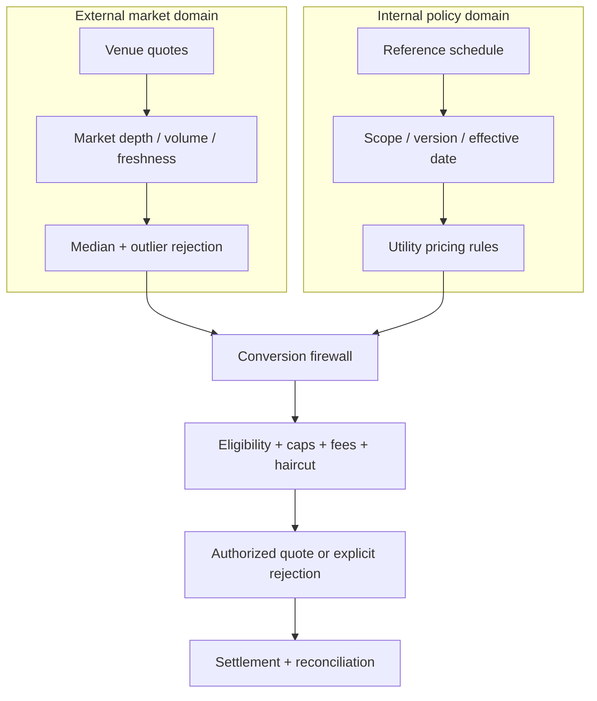
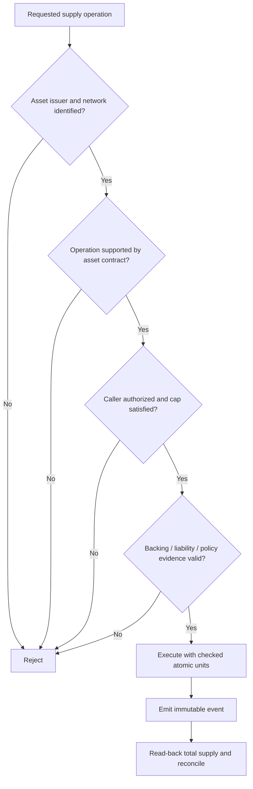
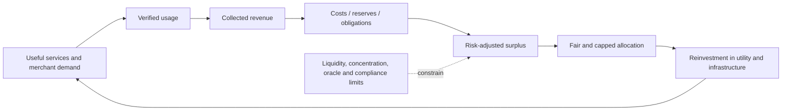
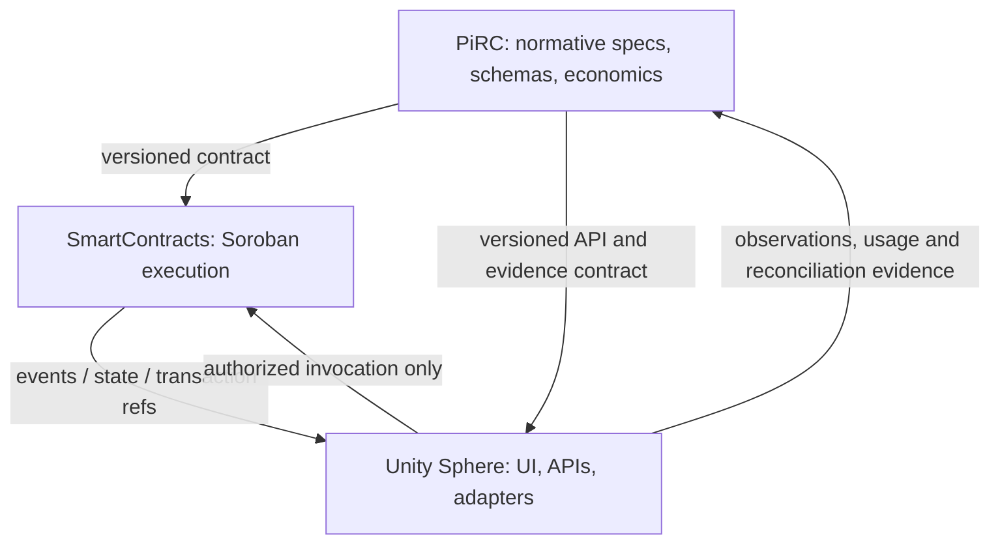

# Integrated Economic Flow Maps

All diagrams describe the proposed reference architecture. They do not assert live Pi Network capabilities.

## A. End-to-end settlement sequence

```mermaid
sequenceDiagram
  actor P as Pioneer / Merchant
  participant UI as Unity Sphere
  participant API as API Gateway
  participant ID as Identity Policy
  participant OR as Oracle & Provenance
  participant EE as Economic Engine
  participant SC as Soroban Contract
  participant L as Configured Ledger
  P->>UI: Create payment / claim intent
  UI->>API: Typed request + idempotency key
  API->>ID: Authenticate and authorize
  ID-->>API: Scoped decision
  API->>OR: Resolve asset, network, price evidence
  OR-->>API: Quorum result + evidence hash
  API->>EE: Evaluate policy, caps, fees, liquidity
  EE-->>API: Quote / reject with reason
  API->>SC: Authorized state transition
  SC->>L: Submit supported transaction
  L-->>SC: Finality / ledger result
  SC-->>API: Event + transaction reference
  API->>API: Read-back and reconcile
  API-->>UI: Status with evidence and freshness
  UI-->>P: Final status; no optimistic success
```

## B. Economic period close



## C. Dual value domains



## D. Mint/burn/lock decision tree



## E. Economic scale loop (utility-led, not supply-led)



## F. Cross-repository ownership



## Review checklist

- Every arrow has an authenticated interface and version.
- No UI-only state is treated as ledger truth.
- Oracle values include source, timestamp, confidence, network and asset identity.
- Contract state changes are idempotent and emit events.
- Read-back is performed before a transaction is shown as final.
- Errors distinguish rejected policy, unsupported capability, RPC failure, timeout and unknown finality.
