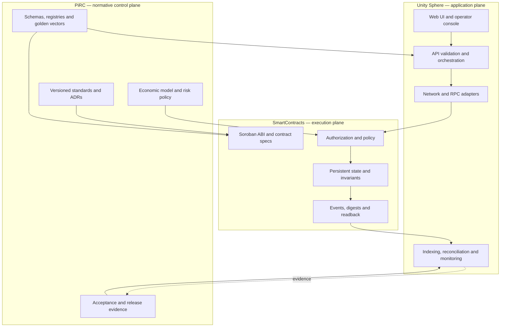
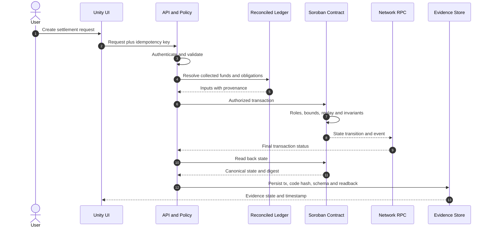
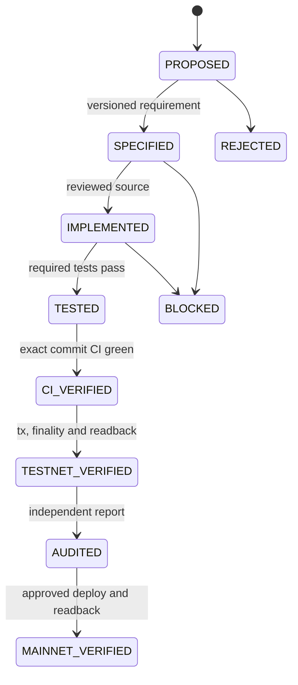

# Integrated System Blueprint — 2026-11-03

**Status:** Proposed engineering baseline for review. Not an official Pi Network specification, deployment attestation, banking authorization, reserve audit, or price commitment.

## Repository ownership

| Repository | Authoritative responsibility | Does not establish |
|---|---|---|
| PiRC | Normative proposals, economics, schemas, governance, architecture and acceptance criteria | Pi Core Team policy or deployed behavior |
| SmartContracts | Soroban/Rust ABI, storage, authorization, events, contract tests and build artifacts | Network deployment or independent audit |
| Unity Sphere | UI, APIs, network adapters, indexing, monitoring and operational evidence | Chain truth from client state or simulated markets |

PiRC defines requirements; SmartContracts implements contract behavior; Unity Sphere consumes versioned interfaces. Cross-repository changes pin exact refs and schema versions.

## Logical architecture

## Trust boundaries

1. Browser input is untrusted. The client cannot authoritatively set revenue, reserves, eligibility, distributable amounts, payment completion or transaction finality.
2. API validates schema, authentication, idempotency, amount/asset/network allowlists and policy version.
3. Accounting inputs come from reconciled server-side records. Oracle observations require source identity, units, timestamp, sequence, signature and freshness.
4. Contracts independently enforce authorization and state invariants.
5. Signers/relayers are isolated from browsers and general workers. No private key or seed phrase belongs in source or client bundles.
6. Finality requires network-specific transaction status plus contract readback.
7. Monitoring captures correlation IDs without secrets or unnecessary personal data.

## Seven colored proposal layers and shared technical planes

The seven colors are proposal taxonomy/UI semantics, not protocol layers, token classes, prices or official Pi Network categories. The Gold/Indigo conflict remains unresolved until a versioned registry migration is approved. Identity, payments, asset registry, treasury, PiDEX, economic engine, oracle, governance, monitoring and release evidence are shared technical planes, not additional tokens.

## Economic invariants

All monetary values use integer atomic units and an explicit asset ID/scale. Floating-point arithmetic is prohibited for settlement.

For collected revenue G and approved deductions O, T, R, C and Q:

`U = G - (O + T + R + C + Q)`

Require non-negative inputs, checked arithmetic and U >= 0. Underfunded periods fail with a typed error; they are never silently clamped to zero. For allocations a_i, require sum(a_i) = U, deterministic remainder tie-breaks, duplicate rejection and no state mutation on rejected operations.

Market price, internal reference, merchant quote, collateral valuation and legally redeemable cash are distinct. The ratio 314159 / 0.0314159 = 10^7 is arithmetic only; it creates no conversion right, peg, liquidity or redemption obligation.

## End-to-end settlement

A failed or ambiguous RPC response remains pending/unknown until reconciled. Never retry a non-idempotent payment blindly.

## Evidence lifecycle

No status is inferred from a README, branch name, source file or queued CI run.

## Deployment and release evidence

The Vite frontend can be hosted as a static Netlify site. The existing catch-all API entry follows Vercel conventions and is not automatically a Netlify Function. Until a tested API origin or Netlify Functions adapter exists, Netlify is frontend-only and API paths fail closed.

Each release records immutable repo SHAs, schema versions, exact CI runs, toolchain/lockfile versions, ABI and WASM hashes, threat model, reviewer, Testnet network/tx/finality/readback, rollback plan and known limitations.

## Explicit claims boundary

This blueprint does not claim Pi Core Team endorsement, official Pi Cash/Pi Bank products, GCV pricing, USD peg, OUSD backing, live exchange, redeemable reserves, deployed contracts, Pi Mainnet integration or audited security.
