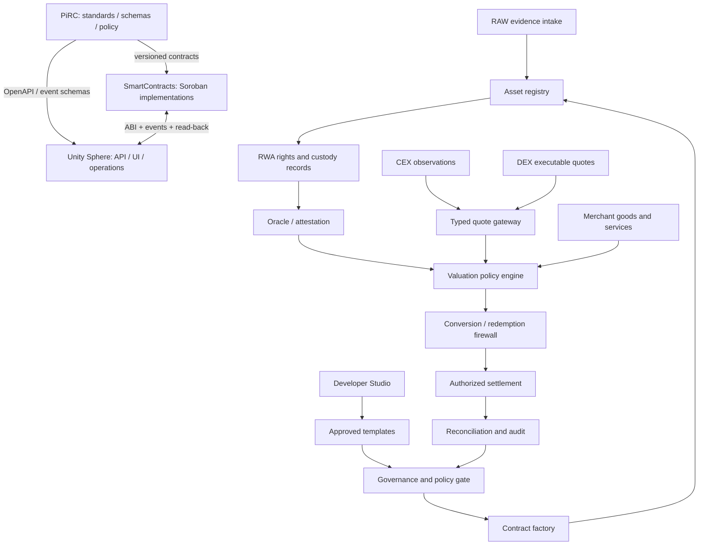
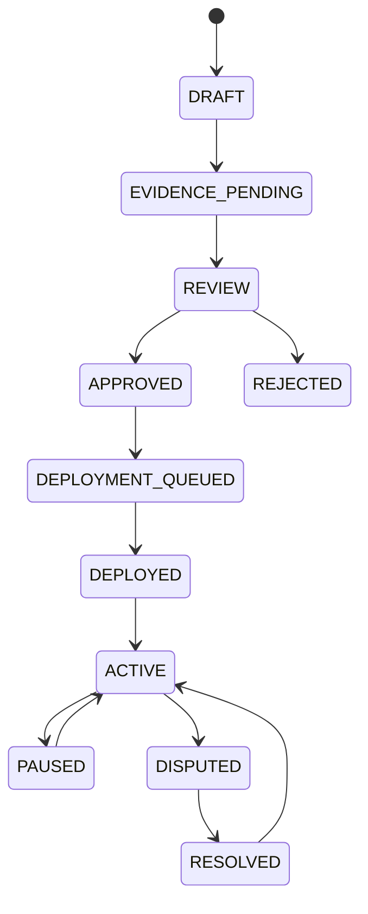

# PiRC Hybrid Ecosystem — Master Architecture

**Status:** Proposed integration baseline. **Authority:** Community engineering specification; not Pi Core Team policy. **Version:** 1.0.0-draft.

## 1. Purpose and boundaries

This document defines how the PiRC standards repository, SmartContracts implementation repository, and Unity Sphere application repository cooperate. It does not assert that a CEX, bank, reserve, redemption facility, Pi Core Team interface, or production contract exists.

| Domain | Authoritative owner | Contract between domains |
|---|---|---|
| Economics, governance, schemas, standards, release gates | PiRC | Versioned specifications and JSON schemas |
| Soroban contracts, storage, authorization, events, contract tests | SmartContracts | ABI/interface manifest, contract version, code hash |
| APIs, UI, orchestration, indexers, adapters, operations | Unity Sphere | OpenAPI/event schemas, adapter contract, observability |
| Network capability | Actual network/provider | Explicit network ID, endpoint, verified transaction and read-back |

No repository should vendor a full sibling repository as its source of truth. Cross-repository integration is by immutable source SHA, versioned interfaces, and compatibility tests.

## 2. System context

## 3. Seven-layer reference model

The seven layers are functional domains, not seven currencies. Currency/token identities must be separately declared in the asset registry. Do not infer that color names, layer labels, or project aliases represent fungible assets.

| Layer | Domain | Required capabilities | Primary evidence |
|---|---|---|---|
| L1 | Identity and provenance | issuer identity, device identity, key lifecycle, asset origin | signed claims, KYC/KYB status where lawfully available |
| L2 | Data and evidence | RAW records, schema registry, evidence retention, privacy | signed evidence envelope, content hash, timestamps |
| L3 | Contract and execution | templates, factory, registry, Soroban contracts | code hash, deployment tx, read-back, tests |
| L4 | Oracle and valuation | source adapters, quorum, freshness, unit normalization | signed observations, policy version, confidence |
| L5 | Liquidity and exchange | CEX/DEX quote adapters, AMM, routing, slippage | executable quote, reserves, venue, fees |
| L6 | Governance and risk | approvals, limits, disputes, pause, incident controls | quorum record, decision, audit trail |
| L7 | Application and settlement | merchant checkout, treasury, allocation, reconciliation | payment event, settlement record, receipt |

**Unresolved taxonomy:** the historical Gold and Indigo terms remain distinct until an approved ADR supplies their provenance, semantics, ordinal mapping, migration, and compatibility plan.

## 4. Typed financial domains

The following quote kinds MUST remain distinct:

- `USD_NUMERAIRE`: accounting unit for comparison.
- `INTERNAL_REFERENCE`: policy-based internal index; not a redemption promise.
- `MERCHANT_UTILITY_QUOTE`: merchant-specific price/discount/availability.
- `EXTERNAL_CEX_QUOTE`: venue, pair, timestamp, depth and fees specific.
- `DEX_EXECUTABLE_QUOTE`: executable route based on on-chain state and fees.
- `COLLATERAL_MARK`: valuation used for risk haircuts.
- `REDEEMABLE_LIABILITY`: enforceable obligation with issuer, reserves, custody and legal terms.

A quote is never silently cast from one type to another. A conversion requires an explicit policy, units, source, expiry, limits, and audit record.

## 5. Internal and external value boundary

External exchange prices are observations, not automatic inputs to merchant prices or internal utility. Internal utility may be derived from real goods/services, capacity, merchant terms, verified revenue, risk reserves, and transparent governance. It must not be increased by changing decimal precision, multiplying ledger display units, or relabeling an index.

The scenario ratio (314159 / 0.0314159 = 10^7) is exact arithmetic only. It does not establish a 10-million-fold conversion, market price, redemption, or enforceable purchasing power.

## 6. Asset and settlement lifecycle

A state transition is persisted only after authorization, schema validation, idempotency checks, and evidence capture. Financial execution fails closed if network, signer, contract, quote, or read-back is unavailable.

## 7. Non-negotiable invariants

1. Monetary settlement uses integer atomic units and checked arithmetic.
2. Network, asset, issuer, decimals, and quote type are explicit.
3. No fake transaction hash, synthetic deployment ID, or optimistic success response.
4. Every deployment requires a real transaction and verified code/registry read-back.
5. Device evidence requires signature verification, nonce/challenge, key ownership, and revocation checks.
6. An oracle signature proves who signed, not truth, independence, or accuracy.
7. OUSD remains test-only unless legal issuer, reserve, custody, redemption, and reconciliation are independently evidenced.
8. Mainnet signing/deployment/transfer is outside test and CI workflows.
9. AI may propose code or policy changes; only deterministic checks and authorized human/governance gates can approve them.
10. A source branch is preserved; intake is commit-pinned and reviewable.

## 8. Delivery states

Use only these states: `PROPOSED`, `SCAFFOLDED`, `IMPLEMENTED_UNTESTED`, `TESTED_LOCAL`, `TESTED_TESTNET`, `AUDITED`, `DEPLOYED_VERIFIED`, `BLOCKED`, `DEPRECATED`. A CI badge alone cannot advance a capability to production status.

## 9. Release evidence

Every release records repository, branch, source SHA, spec/schema versions, changed paths, test commands and outputs, security review, deployment environment, contract ID/code hash, transaction reference, read-back result, owner, rollback plan, and known limitations.
