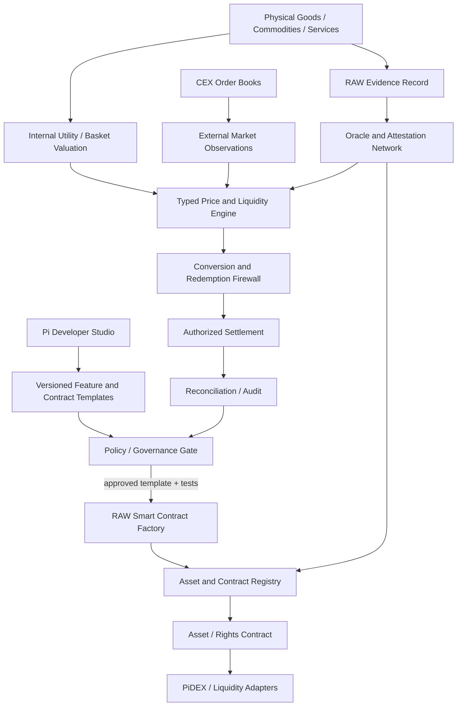
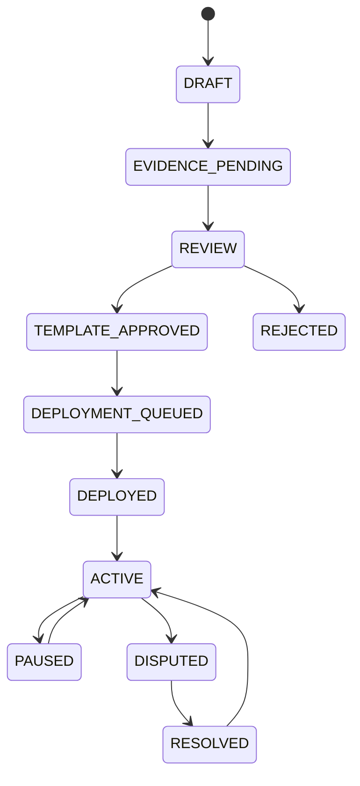
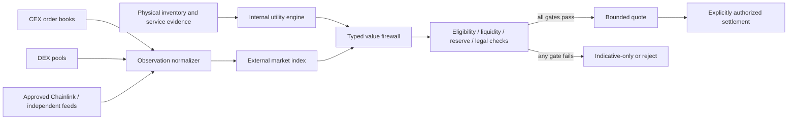
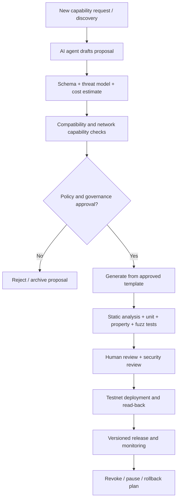

# PiRC Omni Factory and Dual-Economy Reference Architecture

**Document class:** Community engineering specification  
**Status:** Proposed reference architecture; implementation and network capability must be verified per module.  
**Authority:** This document does not represent Pi Core Team policy, an official Pi monetary standard, or a promise of token value, redemption, custody, or liquidity.

## 1. System map

## 2. Domain separation

The architecture MUST keep these concepts in separate typed records:

- **Native Pi:** the network asset and its protocol-defined balances and transfers.
- **Project-issued asset:** a token issued by an identified contract with explicit issuer, network, supply, decimals, rights and liabilities.
- **Mined / migrated / externally acquired Pi:** provenance labels are evidence classifications, not separate token denominations unless the network itself enforces such separation.
- **CEX balance:** a custodial account claim at a centralized venue; it is not a separate native Pi token and is not proof of on-chain ownership.
- **Internal utility credit:** a platform accounting claim, redeemable only under its explicit terms.
- **External quote:** a venue- and pair-specific observation, not a universal price.
- **Internal reference:** a policy-based accounting or utility index, not an external redemption promise.
- **OUSD:** a proposed internal accounting/stability instrument; the current OUSD Soroban crate is test-only and does not provide a peg, reserve, or redemption.

No design may infer that externally acquired units and mined units have different protocol values. If provenance affects eligibility for a specific reward or program, that is a disclosed program rule, not a different market price for fungible Pi.

## 3. RAW record lifecycle and physical-world evidence

A RAW record is an evidence envelope, not proof that an asset exists or that title is valid. A production asset record should include:

1. stable asset ID and issuer / merchant identity;
2. asset class, unit, quantity, condition, location granularity and custody status;
3. legal title / lien / encumbrance references and jurisdiction;
4. inspection and attestation records with signer identity, certificate chain, timestamp and revocation state;
5. sensor evidence (NFC, QR, vision, IoT) with device identity, anti-replay nonce and signed challenge-response;
6. independent valuation, source methodology, confidence interval and expiry;
7. insurance, storage, logistics, proof-of-reserves / proof-of-existence evidence where applicable;
8. privacy policy, retention and selective disclosure controls;
9. immutable revision history and dispute / recall status.

A QR code, NFC UID, image, hash, or scanner-generated SHA-256 digest alone does not prove ownership, authenticity, possession, or legal title. Hardware evidence must be signed by a provisioned device key and independently checked. Physical inspection remains a separate trust assumption.

## 4. Smart Contract Factory

The factory MUST be deterministic and template-based. It MUST NOT deploy arbitrary user-supplied code or silently deploy one contract per product without cost, abuse and governance controls.

Recommended lifecycle:

Required controls: approved template hash, schema version, network ID/passphrase, issuer authorization, per-issuer quotas, deployment fee budget, idempotency key, deterministic salt, code hash, registry write, event, read-back, pause/upgrade policy, and independent audit. A factory response may say `SUBMITTED` or `DEPLOYED` only after a real network transaction and verified read-back.

The current branch artefact `raw_record_factory.rs` only emits an event and returns a product ID; it does not deploy a child contract. The current JavaScript SDK returns a placeholder transaction hash. These are scaffolds, not a working factory.

## 5. Internal value formation: utility before market repricing

USD is a numeraire for comparison. It is not the source of value. Define an internal product/service reference from observable physical and operational inputs:

`V_internal(a,t) = f(Q, condition, scarcity, availability, delivery_cost, service_quality, warranty, demand, substitution, jurisdiction)`

For a basket of products or services:

`I_t = sum_i(w_i × p_i,t / p_i,0) / sum_i(w_i)`

where weights are governance-approved and bounded, and prices are verified local/merchant quotes converted to a common reporting unit only for comparison. The index is not a token exchange rate. It must disclose basket composition, weights, region, time window, data coverage, missing-item policy and revision history.

A service can gain internal utility through better availability, quality, delivery, warranty, merchant acceptance and lower real costs. A system must not mechanically increase a product's internal price merely because more tokens, decimal places, users or contracts exist.

## 6. External market and CEX / DEX price formation

CEX observations: order-book bid/ask, depth, traded volume, trade time, venue, pair, custody/withdrawal status and fees. Use executable VWAP for a specified notional, not last trade alone.

DEX observations: pool reserves, fee tier, invariant, route, price impact, MEV / sandwich exposure, oracle deviation, and block/ledger finality. A pool quote is not equivalent to a CEX order-book quote.

External composite:
`P_ext = robust_aggregate(valid venue observations, liquidity weights, outlier limits)`

The weight of a venue must depend on executable depth and data quality, not simply reported volume. Stale, thin, suspended, manipulated or non-withdrawable venues are excluded or haircutted.

## 7. Dual-value firewall

A conversion requires exact asset and network identity, quote expiry, source quorum, deviation bounds, liquidity, fee disclosure, user authorization and legally enforceable issuer terms. Without these, show indicative information only. Never multiply internal balances by `P_internal / P_external` or a sovereign factor to create cash claims.

## 8. OUSD stability architecture

The current `ousd_test_token` contract is a permissioned test token with a fixed software cap and seven decimals. It has admin mint/burn and token transfers. It has no reserve ledger, redemption, collateral ratio, liquidation, oracle integration, or USD peg.

An internal-stability design should prefer a **unit-of-account / basket-denominated credit** before claiming a USD stablecoin. If OUSD is intended to be redeemable at USD parity, it requires an identified legal issuer, reserve assets, segregated custody, liability ledger, independent attestations, redemption terms, liquidity management, insolvency handling, jurisdictional review and circuit breakers. A basket index can stabilize internal purchasing power but is not USD parity.

## 9. Seven-layer feature taxonomy

The seven colored layers are a community taxonomy, not official Pi protocol layers or seven native currencies. Each layer needs a stable ID, scope, owner, input/output schemas, permitted contract templates, capability requirements, risk class, governance route and conformance tests. A feature is not accepted merely because an AI agent generated code.

## 10. Automatic feature creation and governance

AI agents may propose and generate candidate features. They must not approve their own proposals, hold unrestricted signing keys, deploy arbitrary WASM, change monetary policy, or modify allowlists without human-governed authorization. Every generated artefact records prompt/model version, source commit, template hash, dependencies, test evidence and reviewer.

## 11. Differential geometry and quantitative risk

Differential geometry may support risk modelling, liquidity surfaces and sensitivity analysis. It is not a mechanism for creating monetary value. For state vector `x` (reserves, inventory, demand, volatility, concentration), model a metric `g_ij(x)` as a positive-definite risk/cost geometry and study gradients/Hessians of a disclosed objective `J(x)`. Publish units, domain, calibration, boundary conditions and validation. Do not insert geometric coefficients into token supply or redemption rates without an independently justified economic model.

## 12. Post-quantum migration

Use a crypto-agility layer: algorithm identifiers, key versioning, dual-signature transition, key rotation, certificate revocation, recovery, and signed migration manifests. Evaluate NIST-standardized ML-KEM (FIPS 203), ML-DSA (FIPS 204) and SLH-DSA (FIPS 205) against supported runtimes and resource limits. Hybrid classical/PQ signatures may be used during migration only after protocol and contract support are verified. Do not label a SHA-256 digest or a placeholder SDK log as quantum-safe cryptography. Soroban/Pi Network support for large PQ keys/signatures must be proven before on-chain use; off-chain signed attestations with on-chain hash commitments may be a transitional design, not equivalent to on-chain PQ verification.

## 13. Release evidence

Every feature requires spec ID/version, code hash, contract ID, network, test results, security review, governance decision, oracle source map, deployment transaction and read-back. A source file, green build, mock sensor, or branch name is not evidence of production deployment.
