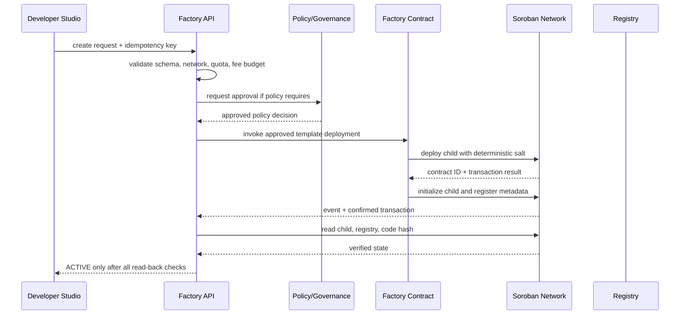

# RAW Evidence and Smart Contract Factory

**Status:** Proposed implementation specification. The word RAW describes an evidence envelope and workflow, not proof of physical existence, title, or possession.

## 1. Component responsibilities

- **Developer Studio:** project configuration, template discovery, schema validation, preview, simulation, deployment request, status and audit view.
- **Template registry:** approved immutable template versions, source hash, ABI, compiler/toolchain, allowed configuration schema, security review and deprecation status.
- **RAW intake:** evidence capture, issuer and asset metadata, device attestations, custody/legal references, revision history and disputes.
- **Factory:** validates policy, deploys approved bytecode with deterministic salt, initializes child contract, registers it, and reads it back.
- **Registry:** maps stable asset ID to issuer, network, contract ID, template version, code hash, evidence root and lifecycle state.

## 2. Factory API contract

Request fields: `request_id`, `idempotency_key`, `network_id`, `issuer`, `asset_id`, `template_id`, `template_version`, `template_hash`, `schema_version`, `constructor_args`, `evidence_root`, `policy_version`, `max_fee_atomic`, `requested_by`.

Response states:
- `VALIDATION_REJECTED`: deterministic input/policy rejection.
- `AWAITING_APPROVAL`: policy or governance approval outstanding.
- `QUEUED`: approved and awaiting execution.
- `SUBMITTED`: a real transaction hash exists; confirmation pending.
- `DEPLOYED_UNVERIFIED`: transaction confirmed but read-back incomplete.
- `ACTIVE`: child contract initialized, registry entry verified, code hash checked, and read-back succeeded.
- `FAILED` / `PAUSED`: terminal or controlled state with reason and recovery path.

Never return a fabricated transaction hash. Never report `ACTIVE` based solely on an event or generated product ID.

## 3. Deployment sequence

## 4. Determinism and abuse controls

- Approved template hash and compiler version are pinned.
- Salt derives from network ID, issuer, asset ID, template hash, and idempotency key using an unambiguous canonical encoding.
- Duplicate idempotency keys return the original request result; they never create duplicate children.
- Per-issuer deployment quotas, rate limits, fee caps, allowlists and emergency pause are mandatory.
- Arbitrary user bytecode is not accepted by the standard factory.
- Upgrades require explicit compatibility, migration and governance policy.
- Every request and state transition emits an auditable event with correlation ID.

## 5. RAW evidence envelope

Required fields: `asset_id`, `issuer_id`, `asset_class`, `quantity`, `unit`, `condition`, `custody_status`, `jurisdiction`, `title_reference`, `encumbrance_reference`, `inspection_attestations[]`, `device_attestations[]`, `valuation_observations[]`, `insurance_reference`, `evidence_root`, `privacy_policy_id`, `retention_policy`, `dispute_status`, `created_at`, `schema_version`.

A content hash proves integrity of bytes, not truth of the underlying claim. QR/NFC UID, image, location, or timestamp alone does not prove possession or legal ownership.

## 6. Device challenge-response

A trusted device must have a provisioned public key and lifecycle state. The verifier sends a fresh unpredictable nonce and challenge context. The device signs a canonical payload containing nonce, device ID, asset ID, action, timestamp and protocol version. The verifier checks signature, key registration, allowed algorithm, nonce freshness/one-time use, timestamp window, device revocation and binding to the requested asset. Failed checks are rejected; no permissive fallback exists.

Physical inspection, title verification and sensor trust remain independent attestations.

## 7. Factory acceptance tests

- approved template only; unknown template rejected;
- wrong network or template hash rejected;
- duplicate idempotency key creates one child only;
- deployment fee cap and issuer quota enforced;
- initialization failure leaves request non-active;
- registry write failure blocks activation;
- read-back mismatch blocks activation;
- child code hash matches approved template;
- revoked issuer/device rejected;
- pause blocks new deployments and state mutation;
- no placeholder transaction hash in SDK or API responses.
