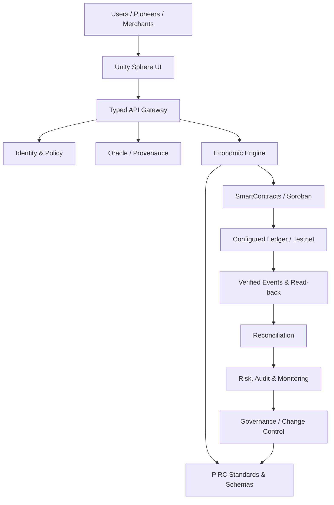
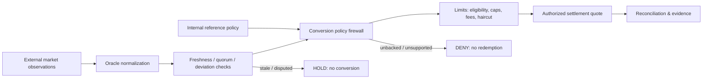
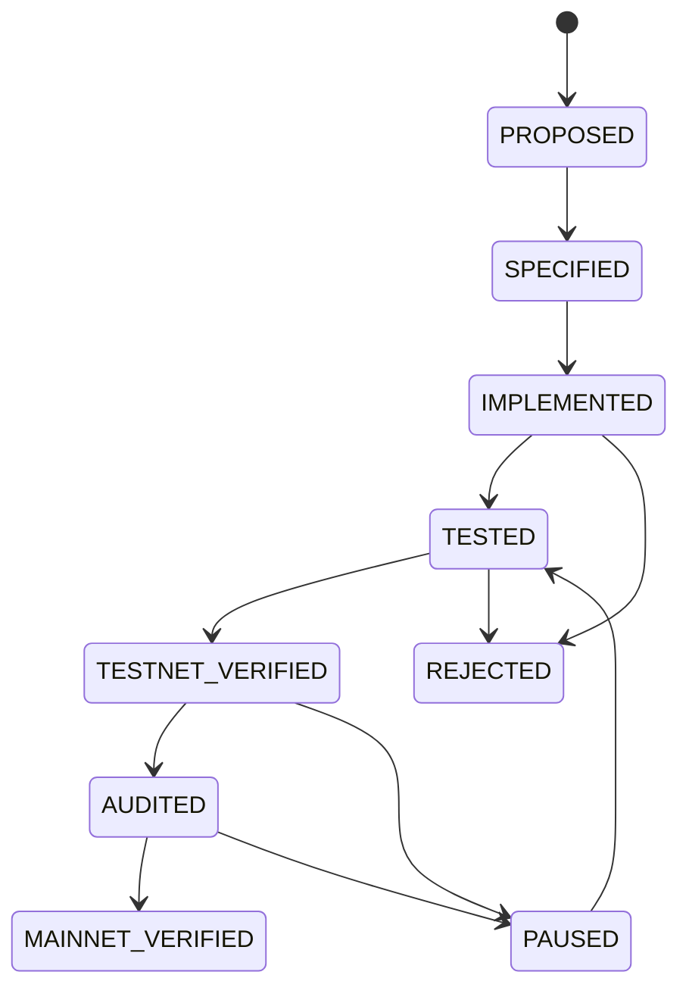

# Integrated Sovereign Economic System Architecture

**Status:** Community research and reference architecture. Not an official Pi Network specification, monetary policy, bank, exchange, reserve, peg, or redemption commitment.

## 1. System boundaries

PiRC is the normative specification layer. SmartContracts is the deterministic execution layer. Unity Sphere is the application, API, adapter, and observability layer. The Pi Network ledger remains an external network boundary: this project cannot change native protocol rules, create native Pi supply, or burn native Pi unless the protocol exposes an authorized operation.

## 2. Value domains: never conflate the units

| Domain | Symbol | Meaning | Evidence required |
|---|---|---|---|
| External observed price | P_ext | Venue-specific market quote for a defined asset/network/market and timestamp | Independent venue observations, depth, freshness, outlier policy |
| Internal reference | P_ref | A policy or accounting reference used inside a defined application context | Versioned policy, scope, effective period |
| Delivered utility | U | Measurable goods/services or protocol utility actually delivered | Fulfilment, invoices, service evidence |
| Collected revenue | R_collected | Revenue actually received and reconciled, not forecast or assessed fees | Ledger/bank/custody evidence and reconciliation |
| Eligible reserve | R_eligible | Assets legally controlled and available for the stated obligation after haircuts | Custodian evidence, liabilities, independent attestation |
| Redeemable liability | L_redeemable | Enforceable redemption obligation | Issuer, terms, jurisdiction, holder rights |

A reference price is not a redemption promise. A market quote is not a reserve. An internal unit is not automatically convertible into an external asset.

## 3. Dual-value bridge and conversion firewall

The bridge must not compute a user's cash entitlement by multiplying an internal reference by an arbitrary sovereign factor. A ratio such as S = P_ref / P_ext is an analytical index only unless a legally enforceable, funded conversion mechanism is separately established. It must never create an arbitrage path between two representations.

For a valid quote, define a policy-specific rate:
`rate = median(valid observations) × confidence_factor × liquidity_haircut`.
Reject rather than extrapolate when the quorum, freshness, network identity, asset identity, or confidence threshold fails. Every quote records source, market, pair, network, timestamp, observation set hash, policy version, and expiry.

## 4. Sovereign index: bounded interpretation

A proposed sovereign multiplier `S = P_ref / P_ext` may be displayed as a scenario or normalization index. It does **not** multiply token balances, create collateral, establish a peg, or authorize redemption. If the example inputs are `P_ref = 314159` and `P_ext = 0.0314159`, the arithmetic ratio is `10,000,000`; that is a mathematical ratio, not proof of economic backing or a realizable exchange rate.

Any future policy using S must state: units, domain, issuer, network, observation window, permitted operations, cap, expiry, risk owner, and independent evidence. The default executable value of S for settlement is **not applicable** until approved.

## 5. Revenue-funded utility and economic expansion

Use collected, reconciled revenue rather than hypothetical volume:
`G_t = collected_gross_revenue_t`
`U_t = G_t - O_t - R_t - T_t - C_t - Q_t`

Where O = operating costs, R = required reserves, T = taxes/mandatory obligations, C = chargebacks/contingencies, Q = prior-period deficits and risk buffers. If any deduction is unknown or U_t < 0, the period is not distributable. Do not silently clamp a deficit to zero and report a successful distribution.

A conservative allowed distribution is:
`U_allowed = max(0, U_t) × Phi_t`
`Phi_t = min(1, (LCR_t / LCR_target)^2)`
`LCR_t = eligible_liquid_assets / stressed_near_term_outflows`

This is a proposed risk control, not an assertion that the project currently has liquid assets or revenue.

Economic expansion means growing real utility, merchant acceptance, service throughput, and collected revenue while maintaining liquidity, reserves, and risk limits. It does not mean mechanically multiplying balances, emissions, or the internal reference price.

## 6. Fairness and contribution allocation

A transparent contribution score can be modeled as:
`w_i = e_i × q_i × r_i × min(w_max, (m_i/m_0)^alpha)`
with `0 < alpha < 1`, where e is eligibility, q is verified quality, r is reliability, and m is independently evidenced contribution. Sublinear alpha reduces domination by very large contributors. The score is not identity, wealth, or a guaranteed entitlement.

`allocation_i = U_allowed × w_i / sum(w)`

Implementation requirements:
- Publish the period, eligible cohort, weights, caps, evidence rules, exclusions, and appeal window.
- Apply deterministic integer arithmetic and largest-remainder allocation; tie-break by stable pseudonymous identifier.
- Prevent duplicate identities, replayed claims, self-dealing, Sybil multiplication, and retroactive weight edits.
- Publish aggregate distributions and privacy-preserving proofs; restrict personal data.
- Include an appeal and correction process with immutable audit events.

Concentration monitoring:
`HHI = sum(share_i^2)`, `N_eff = 1 / HHI`.
Use concentration as a risk signal, not a sole fairness verdict.

## 7. Mint, burn, lock, and release semantics

| Operation | Permitted meaning | Non-negotiable control |
|---|---|---|
| Mint | Create units of a project-issued test/utility asset only where an authorized issuer and policy permit it | Role, cap, backing/liability model, one-time initialization, event, replay protection |
| Burn | Destroy units of an asset whose issuer/contract explicitly supports burning | Authorized holder/issuer semantics, exact amount, event, supply reconciliation |
| Lock | Make units unavailable for a bounded purpose or period | Explicit unlock condition, expiry, emergency handling |
| Release | Return previously locked units after verified condition | Idempotency, evidence, no double release |
| Expire | Close an internal accounting credit/claim according to disclosed terms | Must not be described as burning native Pi |
| Native Pi transfer | Use supported Pi Network wallet/ledger operations | Never emulate with an internal balance or claim custom-contract control |

**Critical distinction:** a Soroban contract cannot burn native Pi merely by decrementing an application database or an unrelated token balance. Native Pi burn capability is outside this project's authority unless the Pi protocol explicitly exposes and authorizes it. Internal credits can be retired in an internal ledger, but must be named `credit_expiry` or `ledger_retirement`, not native-coin burn.

## 8. Seven conceptual layers

The seven colors are a proposal taxonomy and UI map, not official protocol layers or deployed token classes. Preserve the canonical sequence Red, Orange, Yellow, Green, Blue, Indigo, Purple. Gold remains a separate unresolved registry item until a versioned migration is approved. Every layer must map to an owner, schema, API, contract (if any), lifecycle state, and test evidence.

## 9. Lifecycle and release gates

Each transition requires a named artifact, immutable commit/hash, tests, reviewer, environment, and evidence. A successful build is not a security audit. A Testnet read-back is not Mainnet verification.

## 10. Normative invariants

1. No value conversion without asset/network identity, valid oracle quorum, and explicit policy.
2. No distribution from assessed or forecast revenue; only reconciled collected revenue.
3. No mint without issuer authority, cap, and accounting liability treatment.
4. No burn claim without an actual supported token burn operation and supply read-back.
5. No redemption claim without enforceable terms, eligible reserves, custody evidence, and independent attestation.
6. No settlement on stale, disputed, replayed, or mismatched-network evidence.
7. All monetary arithmetic uses integer atomic units, checked operations, deterministic rounding, and explicit overflow handling.
8. Every user-facing metric labels whether it is observed, derived, simulated, proposed, or verified.

## 11. Related specifications

See the economic mathematics, monetary model, internal/external value bridge, treasury model, oracle governance, schema registry, cross-repository interface contract, threat model, and release acceptance checklist in this repository. SmartContracts owns executable contract behavior; Unity Sphere owns API/UI presentation and operational adapters.
