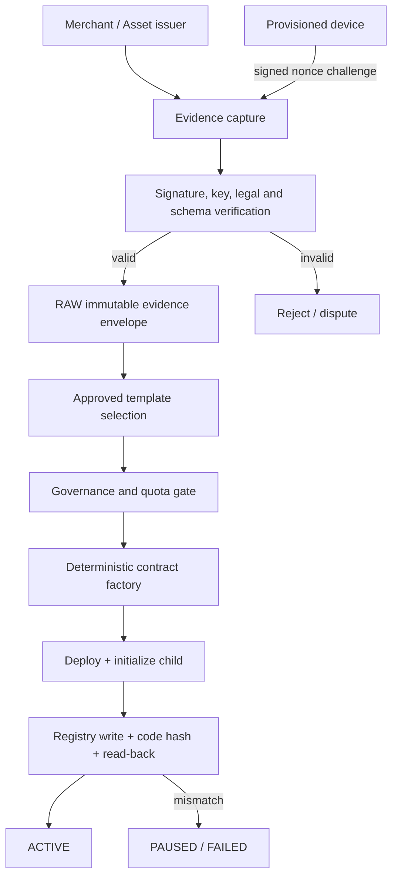
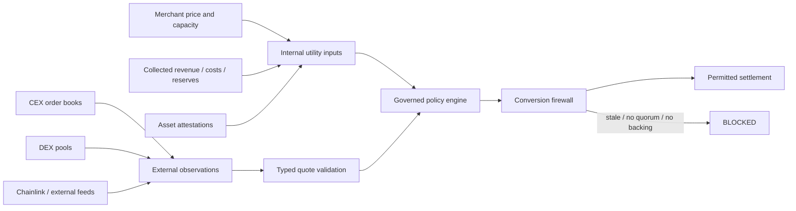
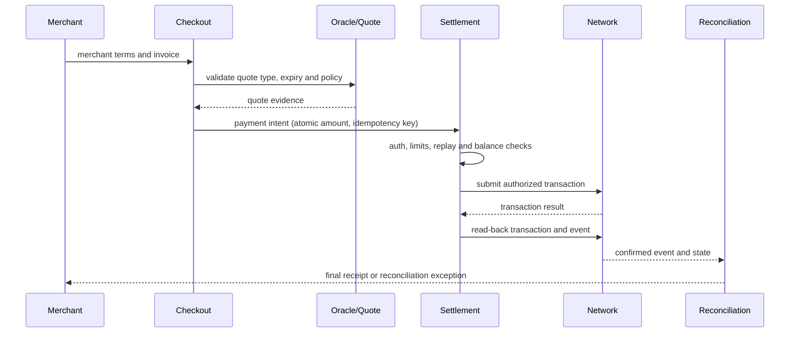
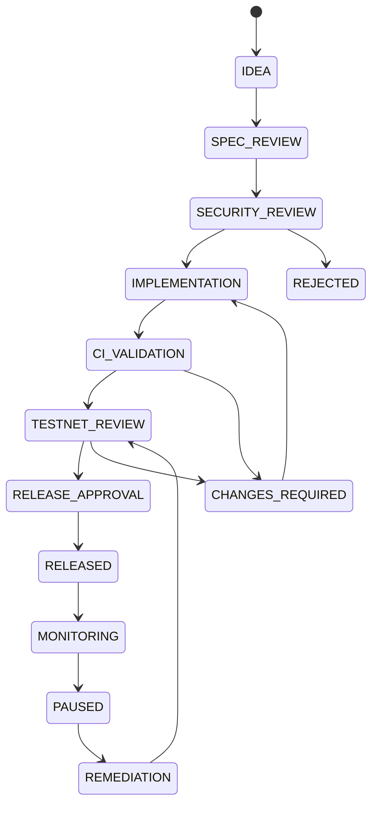

# End-to-End Factory, Oracle, Liquidity and Settlement Flows

## 1. Factory and RAW evidence

## 2. Price and utility flow

## 3. Settlement lifecycle

## 4. Governance-controlled feature lifecycle

