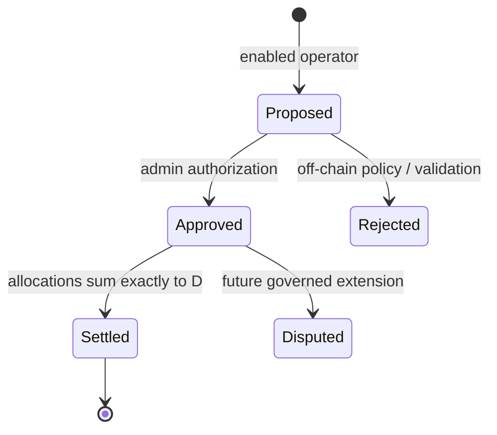

# Economic Settlement Contract Handoff

**Status:** Cross-repository interface agreement draft, 2026-11-03. The linked contract is a draft implementation, not a deployed or audited system.

## Ownership and source of truth

| Layer | Repository | Responsibility |
|---|---|---|
| Normative model | PiRC | Accounting invariants, policy versions, canonical vectors and release gates |
| Execution state | SmartContracts | Soroban authorization, period state, allocation records and finalization digest |
| Application orchestration | Unity Sphere | Request validation, source-data resolution, signing workflow, transaction monitoring and read-back |

The implementation under review is in [SmartContracts PR #1092](https://github.com/Ze0ro99/SmartContracts/pull/1092). The application mapping is in [Unity Sphere PR #33](https://github.com/Ze0ro99/project-unity-sphere-0e2c810d/pull/33). These are separate draft pull requests and are not merged.

## Accounting invariants

All monetary quantities are non-negative integer atomic units of one declared asset per period.

```text
D = R - C
0 <= C <= R
A = Σ a_i
0 <= A <= D
settle_allowed ⇔ state = APPROVED ∧ A = D
```

- `R`: collected revenue resolved by the trusted server-side accounting process.
- `C`: aggregate deductions.
- `D`: distributable amount calculated by the contract.
- `a_i`: one unique participant allocation.
- `A`: aggregate allocation total.

The contract enforces `D` and `A` conservation. It does not independently establish that `R`, `C`, participant eligibility or evidence hashes are truthful.

## Contract state machine



Only Proposed → Approved → Settled is implemented in the initial contract slice. Rejected and Disputed are policy/workflow states, not callable contract transitions in this version.

## Cross-layer identifier and digest contract

The API accepts a canonical human-readable period identifier, while Soroban stores a fixed 32-byte key:

```text
period_key = SHA256(UTF8("PIRC-PERIOD-V1\n" + canonical_period_id))
```

The input digest commits to the canonical server-side accounting bundle. The settlement digest commits to network, contract, period key, input digest, allocation manifest digest and final allocated total. Canonical serialization must be UTF-8, lexicographically sorted JSON keys, no insignificant whitespace, integer-only amount fields and no floating-point numbers.

Hashes are integrity commitments to submitted bytes; they do not prove the truth, custody, completeness or legal status of external evidence.

## Event and finality contract

The contract emits lifecycle events for period proposal, approval, allocation recording and settlement. The application adapter must persist the transaction hash, network, contract ID, ledger sequence, period key, schema/policy version and a read-back snapshot.

The API may return `settled` only when:
1. the network transaction reaches the configured final status;
2. the period read-back reports `Settled`;
3. the stored settlement digest matches the locally computed expected digest.

Timeout or missing read-back maps to `unknown`, not `failed` or `settled`. Reconcile transaction status and contract state before retrying.

## Required shared test vectors

1. Revenue 1,000 less deductions 500 gives distributable 500.
2. Amount 10 across equal weights for canonical participant IDs Alice/Bob/Carol gives 4/3/3 using deterministic largest remainder.
3. Deductions greater than revenue reject the period.
4. Allocation sum below distributable rejects finalization.
5. Allocation sum above distributable rejects the allocation.
6. Duplicate period, duplicate participant allocation and duplicate settlement reject.
7. Unauthorized operator and unauthorized approver reject.
8. Repeated API idempotency key and unknown transaction state reconcile without double execution.
9. Period identifier and canonical JSON digest test vectors match across Python, API and Soroban clients.

## Unresolved before Testnet verification

- Contract test suite must pass the pinned SDK workspace CI.
- Rust contract tests must consume or be mechanically compared to the canonical shared JSON vectors.
- API/client hash canonicalization vectors must be added and cross-validated.
- Storage TTL, bounded participant growth and resource ceilings must be measured.
- Multi-party approval, independent evidence validation and dispute/adjustment governance require design review.
- Token transfer/custody integration is explicitly out of scope for the current contract slice.
- A named Testnet deployment, transaction evidence and state read-back are required before any Testnet-verified status.

## Non-claims

This work does not establish GCV as an official Pi Network price, a Pi/USD peg, redemption rights, reserve backing, custody, liquidity, solvency, Pi Core Team endorsement or Mainnet readiness.

## Implementation alignment note (2026-11-03)

The current SmartContracts PR identifies `contracts/pirc_economic_settlement` as the canonical crate for this handoff. The workspace also currently discovers a second overlapping crate at `contracts/economic_settlement` with a different public ABI and state representation. This duplication is an explicit pre-release blocker: the SmartContracts maintainers must consolidate the implementations or document a deliberate compatibility boundary before Unity Sphere freezes its adapter against either ABI. Until then, the API mapping is provisional and must not be treated as a stable contract interface.

The focused canonical crate test module has now been wired into the Rust module tree, and duplicate-allocation / over-budget regression cases were added. These are authored tests only; the latest observed hosted validation runs remain queued/pending, so no passing result is asserted.
