# Oracle Quorum and Market Data Standard

## 1. Observation is not truth

A valid signature proves that an authorized key signed a payload. It does not prove accuracy, independence, liquidity, or economic enforceability. Every observation is source-attributed and retained with its original units.

## 2. Observation schema

Required fields: `observation_id`, `feed_id`, `source_id`, `source_type`, `base_asset`, `quote_asset`, `price_integer`, `price_scale`, `volume_integer`, `volume_scale`, `observed_at`, `received_at`, `sequence`, `signature`, `signer_key_id`, `network_id`, `venue`, `market_pair`, `methodology_version`.

Never accept a floating-point price as the canonical signed value. Normalize into an integer plus scale only after validating the source's declared units and decimals.

## 3. Validation pipeline

```mermaid
flowchart LR
  A[Exchange / DEX / Merchant / Asset attestation] --> B[Signature and key status]
  B --> C[Schema, unit and network validation]
  C --> D[Freshness and sequence / replay checks]
  D --> E[Source independence and venue concentration]
  E --> F[Quorum and outlier policy]
  F --> G[Confidence / liquidity / deviation bounds]
  G --> H[Governed valuation policy]
  H --> I[Typed quote with expiry]
  I --> J[Conversion firewall]
```

Reject invalid signatures, stale observations, reused sequence/nonces, unknown assets, malformed scales, duplicate source ownership, insufficient independent sources, excessive dispersion, low-liquidity manipulation, and unsupported feed coverage.

## 4. Quorum and aggregation

A production feed must define a minimum count of independent sources, minimum independent operators, source weighting caps, median or robust estimator, maximum deviation, minimum depth/volume, freshness window, fallback and circuit-breaker behavior. A list of authorized reporters or a single latest record is not a quorum.

Aggregation output must include the contributing observation IDs, excluded observations and reasons, estimator, policy version, confidence interval, dispersion metric, expiry and status. If quorum fails, return `UNAVAILABLE` or `STALE`, never a stale last-good price silently.

## 5. Chainlink and network adapters

An EVM AggregatorV3 consumer and a Soroban contract are different execution environments. Each adapter must pin chain/network identity and feed address, verify decimals, positive answer, round completeness, updatedAt freshness, heartbeat/deviation assumptions, access restrictions, and source documentation. Do not assume an EVM feed is callable from Soroban without a separately verified bridge or attestation path.

## 6. CEX and DEX

CEX quote includes venue, pair, side, amount, order-book depth, fees, timestamp and withdrawal/credit assumptions. DEX quote includes pool, reserves, fee tier, route, price impact, slippage limit and transaction simulation. Mid-price is not executable price. A CEX custodial balance is not proof of on-chain ownership.

## 7. AI oracle

Model version and proof hash identify an asserted computation artifact; they do not prove correctness of inference. Production use requires reproducible inputs, signed model artifacts, deterministic evaluation where possible, independent benchmark, bounded authority, human/governance review, and explicit rollback. AI cannot authorize a financial action or self-approve its own model/policy update.

## 8. Oracle incident response

On source compromise, key revocation, stale data, abnormal deviation or quorum loss: freeze affected feed, mark derived quotes invalid, stop conversion/settlement paths that depend on it, preserve evidence, notify owners, rotate keys, re-establish quorum and require explicit reactivation.
